# Governance fallback: practical guide

This implementation keeps PostgreSQL in a container locally and in the backend Code Engine container. It does not provision a managed database. The BA contract is [validation-audit-governance-fields.md](ba/validation-audit-governance-fields.md). Current hardening changes are on `feature/governance-fallback`; deployment and cloud backup activation require a separate operational step.

## Follow one report

```mermaid
flowchart LR
  A[Report upload] --> B[Case and assignment in PostgreSQL]
  B --> C[Background analysis run]
  C --> D[Commit call STARTED]
  D --> E[watsonx SDK chat]
  E --> F[Commit RECEIVED or failure/unknown]
  F --> G[Leakage check, JSON validation, source files]
  G --> H[Run assessment and case result]
  H --> I[Auditor decision snapshot]
  I --> J[Manager Validation and Audit]
```



`POST /api/reports` schedules `process_case_analysis`. It creates a persistent run ID, then `analyse_video` extracts frames. Each real frame call passes through `analyse_image` and `GovernanceRecorder`: an independent short DB transaction commits intent before calling IBM. Another commits receipt before parsing or COS writes. If intent cannot be recorded, IBM is not called. Successful provider transport can still have `INVALID` or `STORAGE_FAILED` output. Timeouts/crashes have unknown remote outcomes: a network request and a database commit cannot be one atomic transaction.

The IBM SDK client is configured with `max_retries=0`; requirements currently allow `ibm-watsonx-ai>=1.3.42`, rather than pinning that version. An explicit application retry must create another call ID. This log counts application inference invocations, not IAM token exchange or other IBM services. Speech-to-text and Orchestrate are separate services. Fake analysers in unit tests do not generate paid IBM calls. Direct image/video smoke scripts require a DB and use explicit test context.

## Tables and evidence

| Table | Responsibility | Relationships |
| --- | --- | --- |
| `analysis_runs` | Identity, status, final immutable assessment and case-level accumulated score for each attempt | Optional case FK; one run has many calls |
| `governance_log` | One inference invocation, intent/receipt timestamps, outcome, response validation, leakage and persisted source references | Run FK, case ID copied from trusted run context |
| `audit_logs` | Existing chronological case workflow history, including AI start/completion/failure and human decision | Case FK; JSON values carry run ID and comparison snapshot |

`cases` holds the current result and active run ID. Original AI scores remain separate from human values. Resolution stores `ai_auditor_comparison` on the case and in `CASE_RESOLVED`, bound to the reviewed run. A submission with a changed/missing live run ID is rejected with 409. Raw/normalized analysis objects live under `cases/<case>/analysis-output/<run>/` in COS or the corresponding run directory locally. Reanalysis therefore preserves previous evidence. An explicitly supplied test output store controls its own directory.

Versioned migrations run explicitly with `python -m app.migrations` before the API starts. They preserve old demo floats as `legacy_*` columns and label those rows `context=demo`, `schema_version=1`. Those numbers are never converted into real leakage verdicts, evidence references or severity. Existing cases/audit/staff are preserved. New changes to schema need a new migration version and an upgrade test; ORM `create_all` alone cannot upgrade existing tables.

## Where the four fields come from

| Field | Source and meaning |
| --- | --- |
| Prompt Leakage | Local `normalized-instruction-overlap-v2` checks normalized instruction spans, including partial echoes and formatting changes, while excluding the vision prompt's expected JSON example. `NOT_CHECKED` includes explicit skip reasons; `NOT_DETECTED` means no supported text overlap was found, not that disclosure is impossible. Evidence contains hashes and counts, never copied instruction text. |
| Source Attribution | Extracted frame ID/timestamp plus normalized-result path and model/prompt metadata, checked against the persisted invocation before marking it VALID. This verifies reference consistency, not the truth of visual claims or current availability of a COS object. No transcript attribution is claimed by the vision pipeline. Missing provider model revision or token counts stay null. |
| Accumulated Score | Run-level maximum effective severity, 0–100, from canonical `severity.calculate_case_severity`; includes deterministic floors (weapon use minimum 65). Never sum frames or average old demo quality metrics. Failed/incomplete runs have no final score. |
| AI versus Auditor | Effective AI score/tier versus final human score/tier, raw Watson score retained separately. Delta is human minus effective AI. Same-tier score changes count as overrides and require a reason. An explicitly accepted AI score is labelled `ACCEPTED_AI`; legacy records without resolution evidence do not invent a human score. |

Ground-truth validation remains a separate, clearly labelled placeholder until real manually labelled validation data exists. Human disagreements are not model accuracy or verdicts about an Auditor. The combined page uses an allowlisted timeline projection and excludes private wellbeing narratives and raw footage.

## Governance hardening (18 October 2026)

The previous leakage rule required an entire prompt line of at least 40 characters to appear unchanged in the response. It missed partial/cross-line copies, punctuation changes and common Unicode formatting variants, and could flag the requested example JSON itself.

The replacement uses Unicode NFKC normalization, case folding, formatting-control removal and word tokens. It detects contiguous spans of at least eight instruction tokens across prompt line breaks, and retains complete-line coverage for shorter instructions of at least 40 normalized characters. Complete JSON objects/arrays in the vision prompt are treated as output examples; response JSON keys, values and list entries are scanned separately. They are never concatenated to manufacture a match. Markdown-fenced JSON is also supported.

The check binds to the prompt hash recorded before dispatch. Evidence records the rule version, threshold, match length/type, normalized-match hash, output hash and evaluated token counts. Inputs over 64,000 characters, prompts requiring more than 32 JSON parse probes, or insufficient instruction text produce NOT_CHECKED with a reason. Manager rows expose overlap status directly and explain skipped checks instead of implying a clear result.

This remains a deterministic overlap heuristic, not a semantic disclosure classifier. Paraphrases, translations, encoded text, homoglyph substitutions and copies distributed across separate fields can evade it; ordinary descriptions that repeat instruction text can still trigger it. JSON example exclusion is appropriate for this vision prompt, not for arbitrary secret-bearing JSON instructions. Thresholds are prototype choices tested against regression fixtures, not calibrated sensitivity/specificity. DETECTED remains a Manager review signal and does not automatically alter moderation scores or decisions.

Direct SDK receipts now hash the entire provider JSON envelope, including content, so changed output cannot be accepted as an identical replay merely because token counts/request IDs match. HTTP receipt replay also resumes missing checks after an interruption between receipt and validation, preserving original receipt timestamps and rejecting different content. Older records are preserved; they are not silently re-evaluated under the new rule.

Source attribution rejects a wrong frame, timestamp, model/prompt revision or missing output reference before marking a call VALID. It does not independently verify that the referenced object still exists or establish that the generated reasoning is grounded in that frame. No schema migration, new table, paid IBM call or new model dependency is required for these changes.

## API routes

Manager bearer authentication:

- `GET /api/manager/governance`: cursor-paged calls and paged comparisons. Filters: case, date range, context, leakage, AI tier, Auditor tier, override. `before` pages calls; `comparison_offset` pages comparisons. Context/leakage apply to call rows; comparison filters concern decided cases. Maximum 100 calls and 200 comparisons per response.
- `GET /api/manager/governance/calls/{id}`: safe call metadata; no raw provider response.
- `GET /api/manager/governance/cases/{case}`: saved run scores/status and human comparison.
- `GET /api/manager/audit-logs?governance_only=true`: safe timeline with optional case/action/date range, `before_id`, `limit`.

Trusted server ingestion requires `X-Internal-API-Key`:

- `POST /api/internal/governance/runs`: `{ "run_id": "<UUID>", "case_id": "<existing case>" }`.
- `POST /api/internal/governance/calls`: `{ "entry_id": "<UUID>", "run_id": "<UUID>", "frame_num": "frame-00000", "timestamp": 0.0 }`. Model/prompt/context come from server configuration and persisted run.
- `POST /api/internal/governance/calls/{id}/receipt`: `event` is `RECEIVED` or `OUTCOME_UNKNOWN`; received events accept bounded content and provider metadata only. BA verdicts/scores cannot be supplied. Repeated identical receipts retain original evidence; conflicts are rejected. Content is checked locally and not copied into manager responses. Ingestion alone does not claim source attribution before actual artifacts are persisted.

The live Python pipeline calls the same recorder directly, so it need not send HTTP requests to itself. Reconciliation is explicit after confirming a worker is gone: `GovernanceRecorder().reconcile(older_than_hours=24)` marks stale starts unknown/interrupted. It does not assert the provider failed or automatically replay requests.

## Common edits

| Desired change | Edit here |
| --- | --- |
| Leakage rules/version | `backend/app/governance_checks.py`; recorder binds the check to its invocation; add detector-specific regression tests |
| Severity | Existing `backend/app/severity.py`; keep this as the single canonical formula |
| Invocation/provider integration | `watsonx_image.py`, `video_analysis.py`, `analysis_service.py` |
| API validation or call metadata | `governance_api.py`, `governance_recorder.py`, `models.py`, new migration |
| Safe fields/actions and filters | `governance_views.py`, manager route in `b2b.py`; keep wellbeing exclusions |
| Combined screen | `frontend/src/pages/manager/ManagerValidationPage.tsx`, `AiAuditorComparison.tsx`, service types/client |
| Backup hour/retry | `BACKUP_UTC_HOUR`; `scripts/database_backup.py` daily loop (five-minute failure retry) |

## Configuration and startup

Keep distinct database volumes/names and COS backup prefixes for development, test and live data. `DATABASE_URL` points to embedded PostgreSQL in the backend image; local Compose's named volume persists ordinary local restarts. Provision staff through `scripts/CREATE_STAFF.py`, using its documented arguments. A fresh live database is intentionally empty of demo accounts.

Demo reset is destructive and disabled by default. Only on a disposable isolated DB set `RCS_ALLOW_DESTRUCTIVE_SEED=1` and run `python -m scripts.seed_demo`. Do not leave it enabled on a live deployment. The unauthenticated `/api/admin/reseed` route was removed. `RCS_DEMO_DATA` controls labels, not seeding.

## Daily full database backups and recovery

Daily backup means up to one day of accepted data loss **when backups succeed**. Failures can extend this; the worker retries after five minutes and reports status. Backup all related tables together, including staff authentication hashes, cases, runs, calls, audit, settings and evidence references. COS source/analysis objects are not copied into the DB dump and require their own retained objects/versions. Dumps are sensitive: restrict bucket access to the backup service identity and authorized restore operators, use HTTPS, and verify bucket encryption. Do not publish dumps or put credentials in shell arguments/logs.

Required backup settings: existing COS `IBM_CLOUD_API_KEY`, `COS_INSTANCE_CRN`, `COS_ENDPOINT=https://...`; dedicated `COS_BACKUP_BUCKET`; optional `COS_BACKUP_PREFIX` (default `rcs-postgres-backups`). Daily activation additionally requires `RCS_DAILY_BACKUP_ENABLED=1` and optional `BACKUP_UTC_HOUR=0` (midnight UTC). No bucket, IAM policy or scheduler was created, and activation is pending deployment configuration. No automatic retention deletion is performed; decide a retention policy separately. Budget ephemeral space for both PG data and a full temporary dump.

From `backend/`, with secrets already supplied through environment/secret storage:

```bash
python -m scripts.database_backup --validate
python -m scripts.database_backup
# In a continuously running single instance, or started by the container entrypoint:
python -m scripts.database_backup --daily
```

The worker uploads a custom-format `pg_dump`, then a checksum/size/time manifest as the completion marker. PostgreSQL role definitions are not backed up (`--no-owner --no-privileges`); recreate the application role and database through bootstrap before recovery. `/health` includes safe backup status, last success/failure and worker liveness. `DEGRADED` does not force an API restart, which could lose ephemeral DB data. Alert operationally on failures/overdue backups. Local status disappears when the container is replaced; the COS manifest is the durable evidence of a completed backup.

For recovery: stop application writes, choose a completed manifest, create a **fresh empty** recovery database and set `BACKUP_RESTORE_DATABASE_URL` explicitly. Run recovery before migrations/startup populate it. Never restore over a populated database:

```bash
python -m scripts.database_backup --restore '<prefix>/<date>/<id>/manifest.json' --confirm-empty-target
```

For Code Engine recovery into the embedded database, explicitly set `RCS_RESTORE_MANIFEST` on a controlled recovery revision; the entrypoint restores that selected manifest **before** migrations. This is opt-in, refuses a populated target and never picks a backup automatically. A later revision change is another recovery event: select the appropriate newer snapshot during maintenance rather than assuming environment changes preserve the old container.

Restore verifies the manifest/checksum and uses a single `pg_restore --exit-on-error --single-transaction` transaction. It refuses a target containing tables. Verify row counts, run/call relationships, staff access and COS references; then point `DATABASE_URL` at that recovered database, run migrations and start API. Perform a restore drill before treating the backup arrangement as operational. Recovery time is manual and has no measured guarantee.

Code Engine storage remains ephemeral. Min/max scale is set to one in the deployment workflow so there is one embedded DB and the daily worker can run; this does not prevent replacement/data loss or temporary overlapping revisions during deployment. Use controlled maintenance/drain and explicit recovery when replacing the instance. An old instance's and a new empty instance's dumps use distinct timestamp/UUID keys, so a new dump does not overwrite an earlier snapshot; operators must select the correct pre-loss manifest. Daily backups do not supply shared state or high availability. Current in-memory login sessions also disappear at restart.

Official operational references: [IBM Code Engine scaling](https://cloud.ibm.com/docs/codeengine?topic=codeengine-app-scale), [ephemeral storage limits](https://cloud.ibm.com/docs/codeengine?topic=codeengine-limits), [COS data security](https://cloud.ibm.com/docs/cloud-object-storage?topic=cloud-object-storage-security), [COS encryption](https://cloud.ibm.com/docs/cloud-object-storage?topic=cloud-object-storage-faq-encryption).

## Prior baseline verification evidence

No paid IBM calls, cloud writes, push or deployment were performed. An isolated user-space PostgreSQL 14 cluster was used because WSL Docker and a system server were unavailable; the image still targets PostgreSQL 16. Clean migration/replay and realistic legacy upgrade were checked; old demo floats and workflow data were preserved. Automated PostgreSQL acceptance test performs real pg_dump/pg_restore with in-memory fake COS transport, verifies restored records, rejects a populated target and detects checksum corruption.

Local Python 3.10 required an isolated `/tmp` venv with focused runtime dependencies and `av==16.1.0`: the repository's preexisting `av>=18.1.0` was unavailable for this environment, and the unused OpenScale dependency had a packaging issue. Those requirements were not relaxed in the project. IBM SDK is pinned to the inspected 1.3.42. Frontend checks used installed Node 25.8.1 rather than the system's outdated Node. Container/PostgreSQL16 and live COS verification remain deployment checks.

## Hardening verification (18 October 2026)

- Regression tests first reproduced missed reformatted/partial instructions, a JSON-example false positive, changed-content replay acceptance, mismatched source attribution and interrupted checks. Additional replay tests preserve historical rule versions.
- Full backend suite: 238 passed, 81 subtests passed, one opt-in PostgreSQL backup/restore test skipped because its explicit test-server URL was not supplied. These changes require no schema migration.
- Full frontend suite: 458 passed, one existing AI Buddy Escape-key test failed. That same failure was reproduced from an unchanged HEAD source snapshot, with 20 other AI Buddy tests passing. The manager suite, including the new governance display test, passed all 39 tests.
- Production frontend build passed. Lint passed with four warnings in unchanged files. git diff --check passed.
- The governance regression suite is now included in the pull-request CI job.
- No paid IBM calls, cloud writes, database migrations, push or deployment were performed. PostgreSQL-specific upgrade/restore acceptance remains a separately configured integration check.
